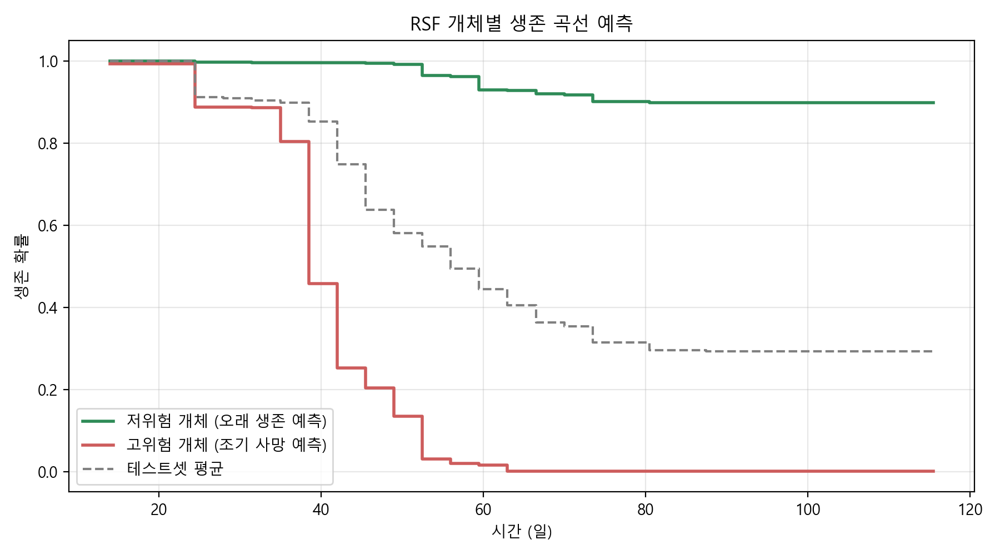
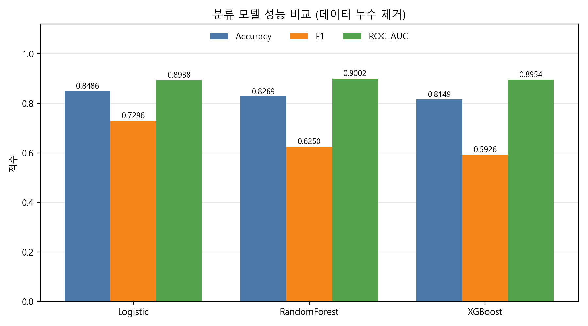
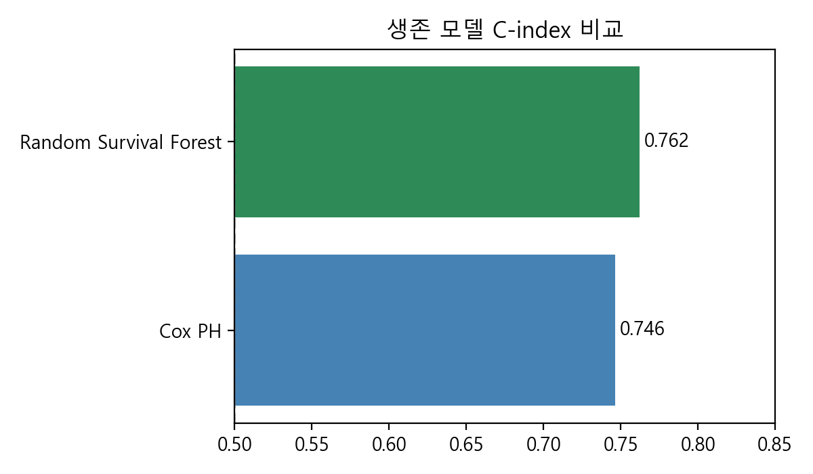
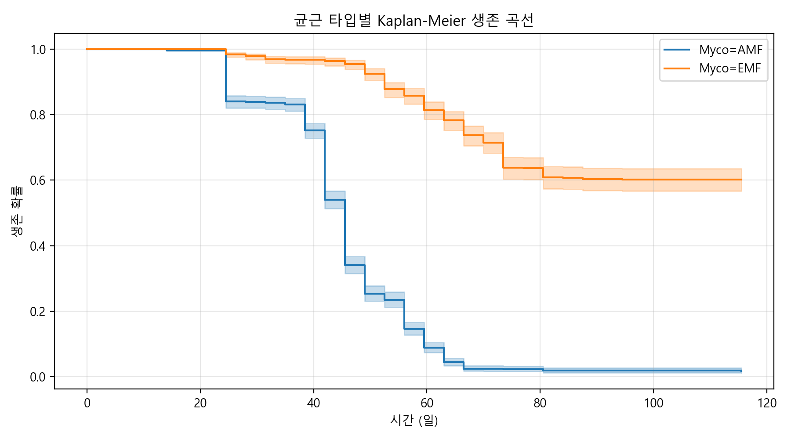
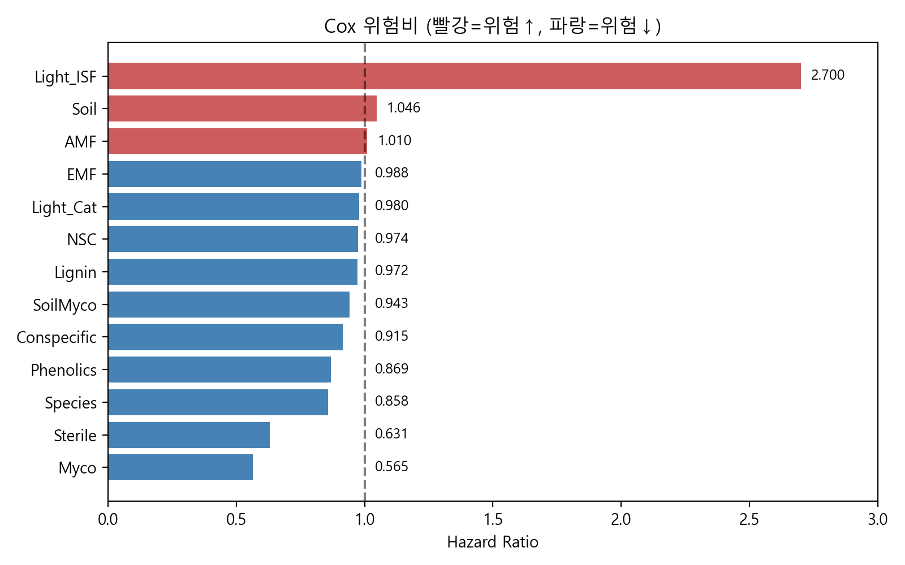
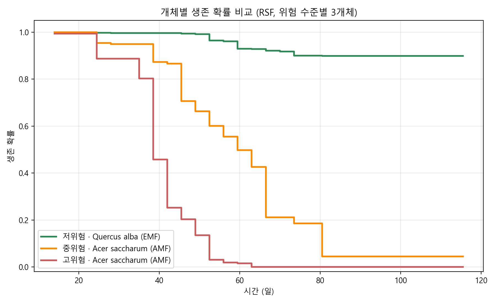
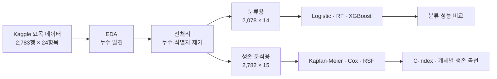

# 도시 수목(묘목) 생존 위험 예측

묘목의 환경·생물·화학 데이터로 **생존 여부와 시간에 따른 사망 위험**을 예측하는 프로젝트입니다.

- **기간**: 2025.09 ~ 2025.10 (팀 프로젝트) → 이후 개인 복기·업그레이드
- **형태**: SK Networks 부트캠프 미니 프로젝트 (4인)
- **원본 팀 레포**: [SKNetworks-AI19-250818/SKN19-mini-3Team](https://github.com/SKNetworks-AI19-250818/SKN19-mini-3Team)



---

## 한눈에 보기

| 항목 | 내용 |
|------|------|
| 무엇을 | 묘목이 살아남을지(분류), 언제 위험해지는지(생존 분석) 예측하기 |
| 데이터 | [Kaggle - Tree Survival Prediction](https://www.kaggle.com/datasets/yekenot/tree-survival-prediction/data), 2,783행 · 24개 항목 (묘목 이식 실험) |
| 흐름 | EDA → 데이터 누수 발견 → 전처리 → 분류 모델 3종 비교 → 생존 분석(Cox·RSF) |
| 최종 성능 | 분류 ROC-AUC 0.90 (RandomForest, 누수 제거) / 생존 분석 C-index 0.762 (RSF) |
| 내 역할 | 데이터 전처리, XGBoost 학습 (팀) / 데이터 누수 제거, 재현성 확보, 생존 분석 확장 (개인) |

---

## 내가 한 일

| 구분 | 담당 | 한 줄 요약 |
|------|------|-----------|
| 팀 | 데이터 전처리 | 라벨 통합, 결측치 처리, 범주형 인코딩 등 모델에 넣을 데이터 정리 |
| 팀 | XGBoost 학습 | 묘목 생존 분류를 위한 XGBoost 모델 학습 |
| 개인 | 데이터 누수 제거 | 결과가 정해진 뒤 기록되는 `Time`이 입력에 들어가 점수가 부풀려진 것을 찾아 제거 |
| 개인 | 재현성 확보 | 분할·모델에 `random_state`를 고정하고, 전처리를 노트북 순서대로 다시 만듦 |
| 개인 | 생존 분석 확장 | 분류가 못 답하는 "언제 위험해지는가"를 Kaplan-Meier·Cox·RSF로 분석 |

---

## 1. 데이터 전처리

### 어떤 데이터인가

미국 삼림 묘목 이식 실험 데이터입니다. 각 행은 심어진 묘목 한 그루의 기록입니다.

| 구분 | 컬럼 | 내용 |
|------|------|------|
| 환경 | `Light_ISF`, `Light_Cat`, `Soil`, `Sterile` | 조도(연속·등급), 토양 출처, 살균 여부 |
| 생물 | `Species`, `Myco`, `SoilMyco`, `AMF`, `EMF`, `Conspecific` | 수종, 균근 타입(묘목·토양), 균근 감염 비율 |
| 화학 | `Phenolics`, `Lignin`, `NSC` | 식물 내 방어·구조·저장 물질 |
| 결과 | `Time`, `Event`, `Harvest`, `Alive` | 사건 발생 시각, 사망·수확·생존 표시 |

### 어떻게 정리했나

- `Event`·`Harvest`·`Alive` 세 표시를 하나의 상태로 합침: 사망 1,587 · 수확 704 · 생존 491
- 결측 처리: `EMF` 결측은 균이 검출되지 않은 경우라 0으로 채우고, `Event`가 비어 있는 1행은 제거
- `Phenolics`의 음수값(506개)은 최솟값을 0으로 옮겨 보정
- 실험 관리용 식별자(`No`, `Plot`, `Subplot`, `Core`, `Census`, `Adult`) 제거
- 범주형 7개는 Label Encoding하고, 인코딩 맵을 함께 저장
- 목적에 따라 데이터셋을 둘로 나눔

| 데이터셋 | 용도 | 크기 | 특징 |
|----------|------|------|------|
| `clf_dataset` | 분류 | 2,078 × 14 | 수확 제외, 생존 vs 사망 이진, 결과 파생 컬럼 제거 |
| `surv_dataset` | 생존 분석 | 2,782 × 15 | `Time`을 생존 시간으로 유지, 수확·생존은 중도절단 처리 |

### 먼저 확인한 요인

- **균근 타입**이 가장 강한 신호: 묘목의 `Myco`가 EMF이면 생존율 59.6%, AMF이면 1.6%
- **수종**: 참나무류(*Quercus alba* 60.6%, *Quercus rubra* 58.6%)는 잘 살고, *Acer saccharum*(0.2%)·*Prunus serotina*(3.2%)는 거의 죽음
- **화학 성분**: `Phenolics`·`Lignin`·`NSC`가 높을수록 생존 (`Phenolics` 평균 생존 3.88 vs 사망 0.95)

---

## 2. 분류 모델 비교

- Logistic Regression, RandomForest, XGBoost를 **같은 데이터·같은 분할**로 비교했습니다.
- 누수 컬럼을 뺀 뒤 세 모델 모두 ROC-AUC가 0.89~0.90에 모였습니다.
- `Myco`와 `Species` 신호가 뚜렷해서, 복잡한 모델이 아니어도 선형 모델이 정확도·F1에서 가장 좋았습니다.

| 모델 | Accuracy | F1 | ROC-AUC |
|------|:--------:|:--:|:-------:|
| **Logistic** | **0.8486** | **0.7296** | 0.8938 |
| RandomForest | 0.8269 | 0.6250 | **0.9002** |
| XGBoost | 0.8149 | 0.5926 | 0.8954 |

*생존 vs 사망 이진 분류 / 학습 80% · 시험 20% (생존 비율 유지) / `random_state=42`*



---

## 3. 데이터 누수 제거 (개인 업그레이드)

### 왜 다시 봤나

팀 프로젝트의 초기 모델은 성능이 비정상적으로 높게 나왔습니다. 입력 변수를 하나씩 살펴보니 `Time`이 문제였습니다.
`Time`은 "사건이 발생한 시각"인데, 상태별로 거의 완벽하게 갈렸습니다.

| 상태 | `Time` |
|------|--------|
| 생존 | 전부 115.5 (관측 끝까지 생존) |
| 수확 | 거의 전부 약 24.5 (초기에 실험자가 뽑음) |
| 사망 | 14 ~ 115.5로 분산 |

`Time` 하나만 쓴 깊이 1 트리가 생존·사망을 **99.9%** 맞혔습니다(5-fold). 결과가 정해진 뒤에야 기록되는 값이어서, 새 묘목을 심는 시점에는 알 수 없는 정보입니다.


### 실험으로 확인한 결과

일부러 `Time`을 다시 넣어 RandomForest를 같은 조건에서 비교했습니다.

| | Accuracy | ROC-AUC |
|--|:--------:|:-------:|
| 누수 제거 (RandomForest) | 0.83 | 0.90 |
| 누수 포함 (RandomForest + `Time`) | **0.998** | **1.00** |

- 점수는 내려갔지만, 이것이 **예측 시점에 알 수 있는 정보만으로 얻은 점수**입니다.
- 누수를 넣은 모델은 거의 완벽해 보여도 실제로는 쓸 수 없습니다.
- 팀 원본은 분할에 seed가 없어 실행할 때마다 결과가 달랐습니다. 이 버전은 모든 분할과 모델에 `random_state=42`를 고정했습니다.

---

## 4. 생존 분석으로 확장 (개인 업그레이드)

### 왜 해봤나

분류는 관측 종료 시점(115.5일)의 생존·사망 **한 순간**만 맞힙니다. 그런데 실제로 알고 싶은 것은 "이 묘목이 언제쯤 위험해지는가"입니다.
또 분류에서는 수확된 704그루를 버렸지만, 이 개체들도 "그 시점까지 살아 있었다"는 정보를 갖고 있습니다.
여기서는 `Time`이 입력이 아니라 **맞힐 대상(생존 시간)** 이므로 누수가 아닙니다.

### 어떻게 했나

| 항목 | 내용 |
|------|------|
| 생존 시간 | `Time` |
| 사건 | 사망 = 1, 수확·생존 = 0 (중도절단) |
| 모델 | Kaplan-Meier(곡선 추정), Cox 비례위험(위험비 해석), Random Survival Forest(개체별 곡선) |
| 비교 조건 | 같은 학습·시험 분할 (80/20, `random_state=42`) |

### 결과

| 모델 | C-index |
|------|:-------:|
| Cox 비례위험 (lifelines) | 0.746 |
| **Random Survival Forest** (scikit-survival) | **0.762** |



**Kaplan-Meier**: 전체 중앙 생존 시간은 52.5일입니다. 균근 타입으로 나누면 AMF 묘목은 약 25~60일 사이에 생존 확률이 급락하고, EMF 묘목은 약 60% 수준을 유지합니다.



**Cox 위험비**: `Myco`(0.565)와 `Sterile`(0.631)의 위험비가 가장 낮아 생존에 유리합니다. `Light_ISF`는 2.700으로 가장 높게 나왔는데, 다른 변수와 섞인 영향일 수 있어 단독으로 해석하지 않습니다.



**RSF 개체별 생존 곡선**: 위험 점수가 낮은 개체, 중간인 개체, 높은 개체를 골라 비교했습니다.

| 구분 | 수종 (균근) | 30일 | 60일 | 100일 |
|------|-------------|:----:|:----:|:-----:|
| 저위험 | *Quercus alba* (EMF) | 0.996 | 0.929 | 0.899 |
| 중위험 | *Acer saccharum* (AMF) | 0.949 | 0.497 | 0.045 |
| 고위험 | *Acer saccharum* (AMF) | 0.887 | 0.016 | 0.000 |



- RSF가 Cox보다 조금 높았지만, 두 모델 모두 C-index 0.75 안팎입니다.
- 이 그림은 개체 3개를 비교한 것이라 모델 전체의 성능을 보여주지는 않습니다. 성능은 C-index로 봅니다.
- 중위험·고위험 개체가 모두 AMF 단풍나무인 것은 이 데이터에서 수종과 균근 타입이 강하게 얽혀 있기 때문입니다.

### 실무 시사점

- **EMF 균근과 공생하는 수종(참나무류 등)** 을 우선 식재하면 초기 생존율을 높일 수 있습니다.
- 사망이 약 25~60일 사이에 몰려 있으므로, **식재 후 초반에 관리를 집중**하는 것이 효율적입니다.

---

## 전체 구조



---

## 배운 점

- **높은 점수는 먼저 의심해야 합니다.** `Time` 하나로 정확도가 0.83에서 0.998이 되는 것을 직접 확인했습니다.
- **입력은 예측 시점에 알 수 있는 정보여야 합니다.** 결과가 정해진 뒤 기록되는 값은 아무리 잘 맞아도 쓸 수 없습니다.
- **같은 변수도 문제에 따라 다르게 쓰입니다.** `Time`은 분류에서는 누수였지만, 생존 분석에서는 맞힐 대상이었습니다.
- **질문에 맞는 도구를 골라야 합니다.** "한 시점의 생존"에는 분류를, "시간에 따른 위험"에는 생존 분석을 썼습니다.
- **복잡한 모델이 항상 정답은 아닙니다.** 이 데이터에서는 Logistic이 정확도·F1에서 가장 좋았습니다.

---

## 사용 기술

| 분류 | 기술 |
|------|------|
| 데이터 처리 | Python, pandas, NumPy |
| 머신러닝 | scikit-learn, XGBoost |
| 생존 분석 | lifelines (Kaplan-Meier, Cox PH), scikit-survival (Random Survival Forest) |
| 시각화 | Matplotlib, Seaborn |

---

## 실행 방법

```bash
# 1. 가상환경 생성 및 활성화 (Windows / Python 3.13)
python -m venv project_env
project_env\Scripts\activate

# 2. 패키지 설치
pip install -r requirements.txt

# 3. notebooks/01 → 04 순서로 실행
#    02를 실행하면 data/processed/에 전처리 결과가 생성됩니다.
```

`data/processed/`는 `02_preprocessing.ipynb` 실행으로 다시 만들어지므로 저장소에서 제외했습니다.

---

## 폴더 구조

```
data/raw/            원본 데이터 (Kaggle Tree_Data.csv)
data/processed/      02 실행으로 생성 (분류·생존 분석 데이터셋, 인코딩 맵)
notebooks/           개인 복기 버전 분석 (01 → 04 순서로 실행)
  01_EDA                 데이터 살펴보기, 데이터 누수 발견
  02_preprocessing       누수 방지 전처리, 데이터셋 구성
  03_classification      분류 모델 3종 비교, 누수 대조 실험
  04_survival_analysis   생존 분석 (Kaplan-Meier · Cox · RSF)
images/              결과 그래프
requirements.txt     패키지 목록
```
